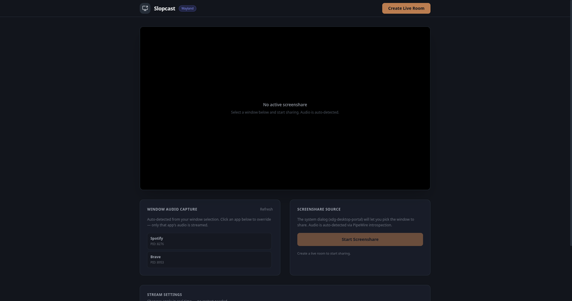

# Slopcast

<p align="center">
  
</p>

Cross-platform screen and audio sharing. Present from the desktop app and watch from any browser.[^1]

<p align="center">
  
</p>

## What is Slopcast?

Slopcast is a room-based screen and audio sharing app. The presenter creates a room in the desktop app, then shares a screen with audio from one selected application. Spectators open the room link in a browser. They do not need an account or an app.

- **Desktop presenter for Linux and Windows.** A Tauri 2 and React interface backed by Rust.
- **Per-application audio capture.** PipeWire handles capture on Linux under Wayland or X11. Windows uses WASAPI process loopback. The stream includes only the selected application's audio.
- **Receive-only browser client.** The web app has no capture controls, and spectator tokens cannot publish.
- **LiveKit SFU.** LiveKit distributes video and audio to spectators without sending a separate stream from the presenter to each viewer.
- **Hardware-accelerated video encoding** when the system supports it.

## How it works

1. **Present.** Launch the desktop app, create a room, and share your screen with audio from one application.
2. **Spectate.** Send the room link to your viewers. They open it in a browser without installing anything or creating an account.

## Development

```bash
# 1. Install dependencies and build the native module
pnpm install
pnpm build:desktop

# 2. Start a LiveKit server in dev mode. `--dev` serves the default
#    devkey/secret that slopcast.config.json already uses, and muxes all
#    WebRTC media onto UDP 7882.
docker run --rm -p 7880:7880 -p 7881:7881 -p 7882:7882/udp \
  livekit/livekit-server --dev --bind 0.0.0.0
#    (or install the binary: curl -sSL https://get.livekit.io | bash)

# 3. Terminal 1: API server
pnpm dev:server

# 4. Terminal 2: web spectator
pnpm dev:web

# 5. Terminal 3: desktop presenter
pnpm dev:desktop
```

Click **Create Live Room** in the desktop app, copy the room link, and open it in a browser.

## Configuration

For local development, Slopcast reads `slopcast.config.json` from the project root. Its LiveKit defaults point to `ws://localhost:7880`. In production, use the environment variables below. Environment variables take precedence over the config file.

### Environment variables

| Variable | Description | Default |
|---|---|---|
| `SERVER_PORT` | API server port | `3001` |
| `WEB_PORT` | Web client port | `3000` |
| `API_ENDPOINT` | URL the web client uses to reach the API | `http://localhost:3001` |
| `WEBSITE_URL` | Public web app URL (used in generated share links) | `http://localhost:3000` |
| `LIVEKIT_URL` | LiveKit server WebSocket URL (how the server reaches the SFU) | `ws://localhost:7880` |
| `LIVEKIT_CLIENT_URL` | LiveKit URL advertised to clients (browsers/desktop app) | falls back to `LIVEKIT_URL` |
| `LIVEKIT_API_KEY` | LiveKit API key | `devkey` |
| `LIVEKIT_API_SECRET` | LiveKit API secret | `secret` |

## Deployment

### Docker Compose

The included `docker-compose.yml` runs a LiveKit development server, the API server, the web client, and nginx on the default Docker bridge network. Nginx listens on port 80. It sends `/` to the web client and proxies `/api/*`, `/health`, and `/ws` to the API server. See `nginx.conf` for the full configuration.

```bash
docker compose up -d
```

The stack publishes ports `80` for nginx, `3000` for the web client, `3001` for the API, `7880` for LiveKit signaling, `7881` for LiveKit ICE/TCP fallback, and `7882/udp` for WebRTC media. In development mode, LiveKit sends all media through the single UDP port. The compose file uses LiveKit's default `devkey` and `secret`, which match the API server environment. For same-machine testing, open `http://localhost`.

### LiveKit URLs in containers

Two LiveKit URLs exist, and under Docker they differ:

- `LIVEKIT_URL` tells the API server how to reach the SFU. Inside the compose network, use the container hostname `ws://livekit:7880`. Only containers on that network can resolve it.
- `LIVEKIT_CLIENT_URL` is the LiveKit URL returned to browser spectators and the desktop app. Clients must be able to reach it, so do not use the container hostname. When unset, it falls back to `LIVEKIT_URL`. The compose file uses `ws://localhost:7880` for same-machine testing. For remote spectators, set a public endpoint such as `wss://livekit.example.com`.

### LiveKit without `--dev`

Use `--dev` only for local development and evaluation. Its default `devkey` and `secret` let anyone mint tokens. In production, configure LiveKit with real credentials. Set `LIVEKIT_KEYS=api-key:api-secret` or pass a key file with `livekit-server --keys keys.yaml`. Then point Slopcast's `LIVEKIT_URL`, `LIVEKIT_API_KEY`, and `LIVEKIT_API_SECRET` to that server and key pair.

Outside development mode, LiveKit uses UDP ports 50000 through 60000 for media and TCP port 7881 for ICE/TCP fallback. Publish those ports and set `rtc.use_external_ip: true` or `--node-ip` so the SFU advertises an address clients can reach. In `docker-compose.yml`, remove `--dev` from the `livekit` service and set `LIVEKIT_KEYS` in its environment.

### Reverse proxy (production)

In production, use a reverse proxy to serve the web app and API from one domain. The examples below use `app.example.com`.

#### Nginx

Create `/etc/nginx/nginx.conf`:

```nginx
http {
  server {
    listen 80;
    server_name app.example.com;

    location / {
      proxy_pass http://127.0.0.1:3000;
      proxy_set_header Host $host;
      proxy_set_header X-Real-IP $remote_addr;
      proxy_set_header X-Forwarded-For $proxy_add_x_forwarded_for;
      proxy_set_header X-Forwarded-Proto $scheme;
    }

    location /api/ {
      proxy_pass http://127.0.0.1:3001;
      proxy_set_header Host $host;
      proxy_set_header X-Real-IP $remote_addr;
      proxy_set_header X-Forwarded-For $proxy_add_x_forwarded_for;
      proxy_set_header X-Forwarded-Proto $scheme;
    }

    location /health {
      proxy_pass http://127.0.0.1:3001;
      proxy_set_header Host $host;
      proxy_set_header X-Real-IP $remote_addr;
    }

    location /ws {
      proxy_pass http://127.0.0.1:3001;
      proxy_http_version 1.1;
      proxy_set_header Upgrade $http_upgrade;
      proxy_set_header Connection "upgrade";
      proxy_set_header Host $host;
    }
  }
}
```

For HTTPS, add `ssl` and redirect port 80:

```nginx
server {
  listen 443 ssl http2;
  server_name app.example.com;
  # ssl_certificate /etc/nginx/ssl/cert.pem;
  # ssl_certificate_key /etc/nginx/ssl/key.pem;
  # ... same location blocks as the HTTP example above
}

server {
  listen 80;
  server_name app.example.com;
  return 301 https://$host$request_uri;
}
```

#### Caddy

Create a `Caddyfile`:

```
app.example.com {
  reverse_proxy /api/* 127.0.0.1:3001
  reverse_proxy /health 127.0.0.1:3001
  reverse_proxy /ws 127.0.0.1:3001

  handle {
    reverse_proxy 127.0.0.1:3000
  }
}
```

When the domain's DNS points to the server, Caddy automatically provisions TLS certificates through Let's Encrypt or ZeroSSL. No extra HTTPS configuration is needed.

To use Caddy instead of the default nginx entry point, uncomment the `caddy` service in
`docker-compose.yml` (and comment out the `nginx` service), then place a `Caddyfile`
alongside. On the compose bridge network, Caddy reaches the containers by service name:

```
app.example.com {
  reverse_proxy /api/* slopcast-server:3001
  reverse_proxy /health slopcast-server:3001
  reverse_proxy /ws slopcast-server:3001

  handle {
    reverse_proxy slopcast-web:3000
  }
}
```

## Desktop shortcuts, tray and settings

Open **Settings** from the title bar or tray, or press **Ctrl+,** (**Cmd+,** on macOS).
Settings opens in its own window, can be resized, and closes with **Esc**; closing it
does not stop sharing.
**Settings → Stream** contains the video codec, resolution, frame rate, bitrate,
content motion and API endpoint controls. Changes are shared with the main window
and saved automatically; changing the API endpoint during a room still requires
confirmation.

**Ctrl+T** (**Cmd+T** on macOS) toggles the telemetry overlay only while the main
window is focused. This does not stop streaming or audio. Edit, clear or reset this
local shortcut in **Settings → Shortcuts**.

Default global shortcuts (editable or clearable in **Settings → Shortcuts**):

| Action | Default |
| --- | --- |
| Start screenshare / go live from preview | Ctrl+Shift+F7 |
| Stop screenshare, keeping the room open | Ctrl+Shift+F8 |
| Close room (with confirmation) | Ctrl+Shift+F9 |
| Switch screenshare source | Ctrl+Shift+F10 |
| Mute/unmute the selected audio source | Ctrl+Shift+F11 |

Starting opens the source picker and preview; use the start shortcut again, Go Live,
or the tray's **Go live** item to publish. The tray item is available whenever nothing
is live; with no room open it creates one first, prompts for a window, and the main
window appears with the preview once a source is chosen. Changing sources keeps the
room and audio selection. Cancelling a Linux source picker leaves sharing stopped
rather than silently sharing another source.

On Wayland, global shortcuts use the **GlobalShortcuts desktop portal**, not X11
key grabs. Your desktop must support that portal and approve the bindings. The
Shortcuts page shows the actual approved keys and availability; preferred keys may
be changed by the desktop. Portal version 2 provides a desktop shortcut editor;
on version 1, persistent desktop assignments may need changing in the desktop's
own shortcut settings. Missing or revoked portal access is reported, never treated
as working global shortcuts.

Direct Linux binary launches register a portal identity using hidden desktop metadata
(`org.slopcast.Slopcast.desktop`) in the OS application-data directory. This does not
change the app's settings directory or add a visible launcher.

Right-click the tray icon for sharing, room, audio and Quit controls. Closing the
main window keeps the app running while the tray is enabled; **Quit** stops capture
and closes the room. Linux needs an AppIndicator runtime and a desktop tray host
(GNOME may need an AppIndicator extension).

**Settings → General** can disable the tray, choose a settings folder, and disable
automatic application-audio selection. Folder changes copy preferences, stream
settings and onboarding state safely, retain originals, and reject destinations
containing Slopcast settings. A location pointer remains in the default config
folder; logs, browser data and packaged server configuration are not moved.
Disabling automatic audio starts with **No Audio** unless you explicitly choose a
source. Automatic matching never falls back to capturing all system sound.

## Testing

Tests live under [`tests/`](tests/). Unit tests are grouped by package in `unit/`, cross-application browser tests live in `e2e/`, and native regression probes live in `probes/`.

```bash
pnpm test:unit
pnpm exec playwright install chromium
pnpm build:desktop   # one-time prerequisite
pnpm test:e2e
```

The end-to-end test launches the desktop app, creates a room, starts a screenshare, and verifies that a headless Chromium spectator connects and receives live video.

### Native GUI automation

Use [kwin-mcp](https://github.com/isac322/kwin-mcp) and KWin's virtual framebuffer
instead of Xvfb for isolated native Wayland UI checks. This complements—not
replaces—Playwright's desktop CDP and web spectator tests. The virtual session
checks windows, input and pixels; it does not establish that a real desktop's
PipeWire audio or screen-capture portal works.

Requirements: Linux, KWin/Plasma 6, Python 3.12+, `uv` (`uvx`), D-Bus, libei,
AT-SPI2 and Spectacle. Slopcast's CEF backend also needs `Xwayland`. Installing kwin-mcp's Python dependencies needs a C
compiler, `pkg-config`, Python headers, Cairo, GObject Introspection and libdbus
development files. See upstream's
[system dependency instructions](https://github.com/isac322/kwin-mcp#installing-system-dependencies).
No system packages are installed by the project launcher.

The project MCP entries in `.mcp.json` and `.pi/mcp.json` run
`bash scripts/kwin-mcp.sh`; restart/reload your MCP client after configuration
changes. Pi requires project trust before loading `.pi/mcp.json`. For another
client, use this stdio entry from the repository root:

```json
{
  "mcpServers": {
    "kwin-mcp": {
      "command": "bash",
      "args": ["scripts/kwin-mcp.sh"]
    }
  }
}
```

`pnpm mcp:kwin` starts the same stdio server, not an interactive test runner.
The launcher pins `kwin-mcp==0.11.0`, creates a private runtime directory, strips
host display/session-bus addresses, enables screenshot image results and starts
KWin with `--xwayland` so X11 windows are managed like on a real Plasma session. Each
MCP server owns one virtual session; parallel agents need separate servers.

After building the desktop app, call these MCP tools:

1. `session_start` with `screen_width: 1920`, `screen_height: 1080`,
   `isolate_home: true`. KWin and D-Bus readiness are checked by the server; do
   not guess with fixed sleeps.
2. `launch_app` with `command: "bash scripts/kwin-launch-desktop.sh"`. This finds
   the session KWin's rootless Xwayland display (by the PID in its
   `/tmp/.X<N>-lock` file) and runs `target/release/slopcast` on it. The pinned
   CEF runtime forces X11; a direct native Wayland launch fails to create a
   window. Native Wayland apps can use `launch_app` directly.
3. Observe with `window_geometry`, `accessibility_tree` and `screenshot`; interact
   with `mouse_click`, `keyboard_type`, `mouse_drag` or `window_set_geometry`.
   Confirm the resulting UI or geometry after each action. Webview accessibility
   can be incomplete; retain Playwright DOM assertions for renderer behavior.
4. Always call `session_stop` in cleanup. Server EOF and normal termination also
   stop owned sessions; the MCP launcher then kills any process still using its
   private runtime directory (portals and AT-SPI outlive the session bus) and
   removes it. Set
   `keep_screenshots: true` in `session_start` only when retaining diagnostics is
   useful, and remove the reported screenshot/log directory when finished.

Never use `session_connect` or `--default-live-session` for project testing.
Virtual KWin isolates display, input and the session bus, but is **not** a
filesystem/network sandbox. `isolate_home` gives applications disposable user
settings, not restricted filesystem access. KWin is the X11 window manager, so
window geometry, maximize and focus tools address Slopcast's window directly.
GPU acceleration, screenshot support and portal availability must
be verified on each host; do not treat a software-rendered run as GPU or
capture-path validation.

## Background

Slopcast is a vibe-coded personal project. I plan to maintain it until *an actually good app* for sharing a screen on Linux and Wayland appears.

### Why not use other apps?

- **Discord:** A Nitro subscription is required for high-bitrate video, and a frame-rate higher than 30fps. Not to mention that on my system it captures my entire desktop's audio instead of solely the audio from the window I selected. Streams were often super pixel-y also, especially when there was a lot going on.
- **Vesktop:** Streams just wouldn't start for me, and the app in general was buggy. I also don't like the idea of using a third-party Discord client. It violates Discord's terms of service and has direct access to sensitive conversations.
- **Element:** As of now has no support for screen sharing with audio, and lacks settings to adjust the bitrate, resolution and framerate of the stream. [There's a pending pull request that was made in February of this year](https://github.com/element-hq/element-call/pull/3736#issuecomment-4845070478), but a merge is nowhere in sight. That's not to mention the possible overhead investment of [setting up a homeserver](https://element-hq.github.io/synapse/latest/welcome_and_overview.html) with Element Call - which means a well-configured, resource-hungry Synapse server (+ web server, + PostgreSQL server), a TURN server and LiveKit deployment .. that you then have to convince your friends to register on and use.
- **Jitsi Meet:** Honestly, it's not terrible. The bitrate is good and it's fairly straightforward to create a room and have your friends join. I don't remember what exactly the issue was, but I think it could only share tabs or something, and the audio and latency weren't great in general.

### What makes a good screen-sharing app?

Native Linux desktop support is non-negotiable. A good app should:

- Run natively on Wayland.
  - Use PipeWire introspection to capture one application's audio instead of the entire desktop, as Discord does on Windows.
  - Use the [XDG Desktop Portal](https://docs.flatpak.org/en/latest/desktop-integration.html#portals) picker across desktop environments.
- Use hardware-accelerated video encoding when available.
  - Slopcast has been tested on an RDNA2 GPU with the open-source driver.
  - NVIDIA users should install the appropriate driver for their GPU[^3] and `nvidia-utils`. [Open an issue](https://github.com/Baysul/slopcast/issues) if you run into problems.
- Be free and open source.
- Make it easy for friends to watch a movie together. The interface should stay simple and approachable.
- Let spectators watch without registering or downloading an app.[^2]
- Provide desktop apps for Linux and Windows.

## Project structure

```
apps/
├── desktop/     Tauri 2 + React + Rust (presenter)
├── web/         React browser app (spectator-only)
└── server/      Express room and token API
packages/
├── native-livekit/ Rust LiveKit room + publishing crate (libwebrtc)
├── native-rust/    Rust capture engine (PipeWire/WASAPI audio, video)
└── shared-types/   Shared TypeScript interfaces
```

Slopcast reads room code settings, ports, and LiveKit credentials from `slopcast.config.json` at the repository root. Environment variables can override these values. See [Configuration](#configuration).

## Requirements

### All platforms

- **Node.js** >= 24.0.0
- **pnpm** >= 9

### Desktop app

| Platform | Requirements |
|----------|-------------|
| **All** | [Rust toolchain](https://rustup.rs) (stable), C++20 compiler |
| **Linux** | [PipeWire](https://pipewire.org/) (`libpipewire-0.3-dev`), `xdg-desktop-portal` (Wayland), GStreamer core/app/video development libraries, `gstreamer1.0-plugins-bad`, `gstreamer1.0-vaapi`, `libx11-dev`, `pkg-config`, `clang` |
| **Windows** | MSVC 2022+ (Build Tools for Visual Studio) |

Linux H.264 publishing uses the system GStreamer `vah264enc` element; H.265 uses `vah265enc` with an `x265enc` software fallback (no VA display or driver encode support). The `.deb` declares the LGPL VA and parser plugins as runtime dependencies; the AppImage intentionally relies on the host GStreamer installation (which must provide `gstreamer1.0-plugins-bad` for `vah265enc`, plus `gstreamer1.0-plugins-ugly` for the `x265enc` fallback). Windows keeps the bundled libwebrtc encoder path (H.265 via Media Foundation).

The native Rust crates (`packages/native-rust`, `packages/native-livekit`) are linked directly into the Tauri backend (`apps/desktop/src-tauri`). A C++20-capable toolchain is required (gcc >= 10, clang >= 10, or MSVC 2022+) for libwebrtc.

### Server and web

Both run on Node.js without additional native dependencies. The end-to-end test suite requires Playwright and Chromium:

```bash
pnpm exec playwright install chromium
```

---

[^1]: Currently tested on Chromium-based browsers (Chrome, Edge, Brave, Opera) and Firefox.

[^2]: The presenter still has to download the app, but a spectator **does not.**

[^3]: https://wiki.archlinux.org/title/NVIDIA#Installation
